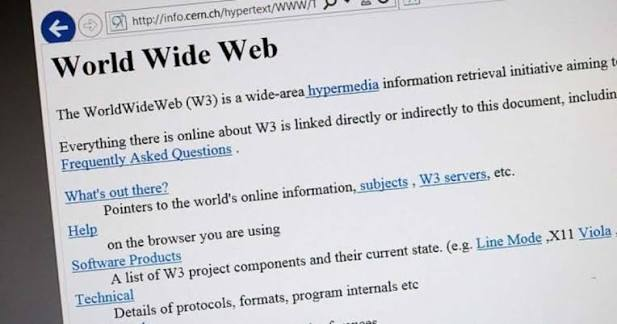

**0)**Introduction To The Web Page:
------------------------------------
0.1)**The Frist Web Page (Frist HTML Document) Is Created By The Tim Berners Lee At 1983.

---------------------------------------------------------------------------------------
0.2)**The Frist Web Page Is Called A World Wide Web (WWW).

---------------------------------------------------------------------------------------
0.3)**The Frist Web Page Is Created By Only The HTML Language To Build The Structure Of Your Own Web Page.

-----------------------------------------------------------------------------------------
0.4)**The Frist Web Page Is A Non Graphical Web Page , Because Tim Berners Less Does Not Use Any Language Else HTML Language To Build The Structure Of The Frist Web Page Without Using Any Styling Language , Or Decorations Language To Make The Styling , Or The Decorations Of The Frist Web Page.

------------------------------------------------------------------------------------------
0.5)**The Second Web Page (Second HTML Document) Is A Graphical Web Page , Because It Is Created By A Group Of Students In The Graduation Project In The University , Because A Group Of Students Using HTML Language To Build The Structure Of The Second Web Page , And Also CSS Language To Make The Styling , Or Decorations Of The Second Web Page (Second HTML Document).

-------------------------------------------------------------------------------------------

