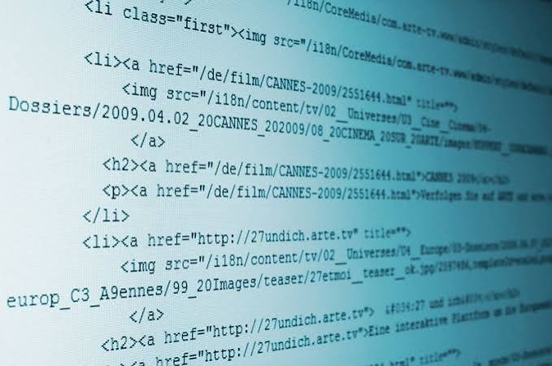
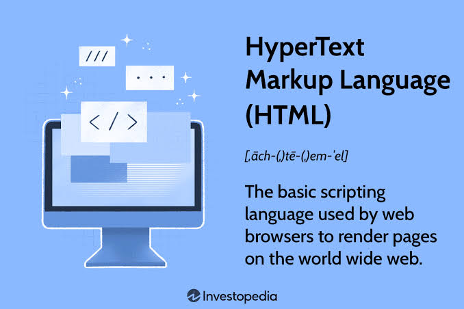
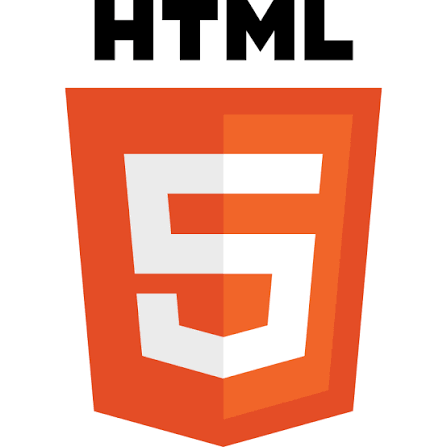

**1)**Introduction To HTML Language:
-----------------------------------------------------
1.1)**HTML: It Refers To The Hyper Text MarkUp Language.

---------------------------------------------------------------
1.2)**HTML: It Is The Main , And Frist Language To Build The Structure Of Your Own HTML Document (Own Web Page).

------------------------------------------------------------------
1.3)**HTML: It Is A Markup Language , Not A Programming Language.

-------------------------------------------------------------------
1.4)**HTML: It Is A Standard Language , Because You Can Not Replace The HTML Language With Any Language To Build The Structure Of Your Own HTML Document (Own Web Page).

--------------------------------------------------------------------
1.5)**HTML: It Has More Than One Versions Like HTML V3 , HTML V4 , And Finally HTML V5.

---------------------------------------------------------------------

---------------------------------------------------------------------------
| | |
