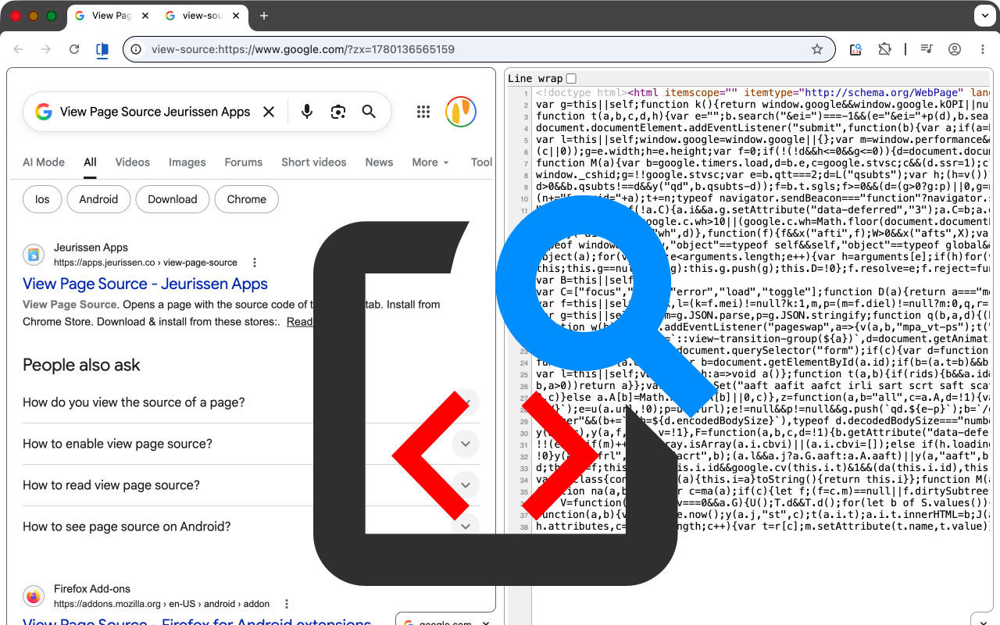
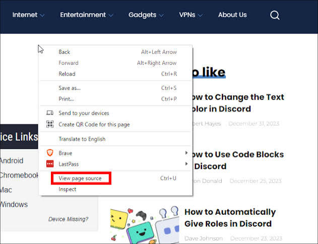
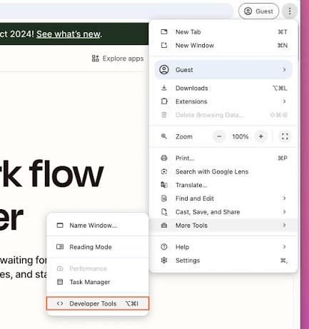
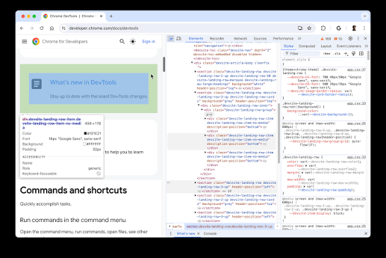

**2)**Elements , And Browsers:
------------------------------------
2.1)**View Page Source: Control (CTRL) + "U" : It Is Mainly Used To Get The Page Source Codes Of Your Own HTML Document (Own Web Page).

|  |  |

---------------------------------------------------
2.2)**Inspect: It Is Used As A Developer Tool To Know Different HTML Element Types From The HTML Language That Mainly Used To Build The Structure Of Your Own HTML Document (Own Web Page).

|  |
|  |

----------------------------------------------------
2.3)**UA Stylesheet: It Refers To The User Agent Stylesheet , It Is The CSS Custom Decorations , Or CSS Custom Styling For Different HTML Elements From The HTML Language That Mainly Used To Build The Structure Of Your Own HTML Document (Own Web Page).

----------------------------------------------------
2.4)**SEO: It Refers To The Search Engines Optimization , It Is Mainly Used To Make Your Own HTML Document (Own Web Page) Appears In The Frist Searching Results In Different Browsers Like Google Chrome , Firefox Developer Edition , Or ETC.

-----------------------------------------------------
2.5)**Web Accessibility: It Is The Practice Of Design , And Developing Of Websites That Can See By Everyone Like People With Disabilities.

