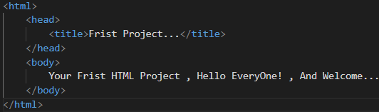
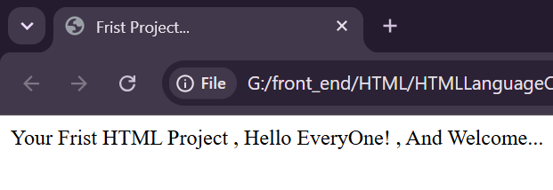

**03)**Your Frist HTML Document , Or Frist Web Page:
-----------------------------------------------------
03.1)**The Frist HTML Document File Of Your Own Project , You Must Name With "Index.html" , "Index" Refers To The File Name , ".HTML" Refers To The Extension Of Your HTML Document File , Because Different Browsers Like Google Chrome , Firefox Developer Edition , Or ETC Searches For "Index.html" File To Start Archiving , Or Rendering Your Own Project From This Point , Because It Is The Entry Point , Or Starting Point...

------------------------------------------------------
*03.2)**There Are Some Different Formats , And Abreviations You Can Use Inside The Text Editor (IDEs) Like Visual Studio Code (VS Code) For Example:
------------------------------------------------------------------------------------------
03.2.1)**TAB: It Is Mainly Used To Make A One Step Forward In Your Own HTML Document File.

-------------------------------------------------------------------------------------------
03.2.2)**SHIFT TAB: It Is Mainly Used To Make A One Step Backward In Your Own HTML Document File.

-------------------------------------------------------------------------------------------
03.2.3)**ALT SHIFT ARROW UP: It Is Mainly Used To Take A Copy Of A HTML Line Up In Your Own HTML Document File.

---------------------------------------------------------------------------------------------------------------
03.2.4)**ALT SHIFT ARROW DOWN: It Is Mainly Used To Take A Copy Of A HTML Line Down In Your Own HTML Document File.

------------------------------------------------------------------------------------------------------------------
03.3)**Different HTML Elements From The HTML Language Are Called HTML Tags.

----------------------------------------------------------------------------------
03.4)**The Main Purpose Of Using Different Formats , And Abreviations Make Your Own HTML Document Codes Very Clean , And Easy To Understand By Different Developers , And Users Of Your Own HTML Document (Own Web Page).

------------------------------------------------------------------------------------------------------------------
03.5)**Syntax Of The Nested HTML Tag Is Containing Of : <Opening TagName> , </Closing TagName> , Between <OpeningTag> , And </ClosingTag> Contains The Tag Scope. Like: <Opening TagName>Tag Scope</Closing TagName> , Tag Scope Refers To Different Contents Between The Opening Tag , And Closing Tag That Appears For Different Users Of Your Own HTML Document (Own Web Page).

-------------------------------------------------------------------------------------------------------------------
03.6)**<HTML>: It Is A Nested HTML Tag , It Refers To Hyper Text Markup Language , It Refers To The Root Of Your Own HTML Document (Own Web Page) , It Contains All HTML Codes Of Your Own HTML Document (Own Web Page).</HTML>.

--------------------------------------------------------------------------------------------------------------------
03.7)**<HEAD>: It Is A Nested HTML Tag , It Refers To The Head Of Your Own HTML Document (Own Web Page) , It Is A Collection Of MetaData For Your Own HTML Document (Own Web Page). , Different HTML Contents Inside Your Own HTML Document (Own Web Page) Does Not Appear For Different Users Of Your Own HTML Document (Own Web Page).</HEAD>.

---------------------------------------------------------------------------------------------------------------------
03.8)**<BODY>: It Is A Nested HTML Tag , It Refers To The Body Of Your Own HTML Document (Own Web Page) , It Is The Content Of Your Own HTML Document (Own Web Page) , It Is The Visible Part For Different Users Of Your Own HTML Document (Own Web Page)..</BODY>.

--------------------------------------------------------------------------------------------------------------------
| Your First HTML Document | Output of Your First HTML Document |
|:---:|:---:|
|  |  |
