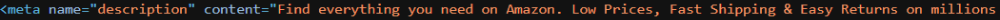
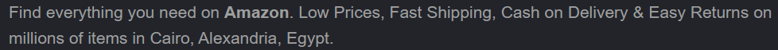
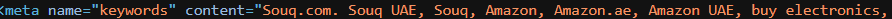
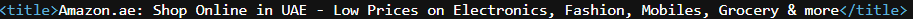
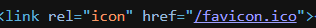
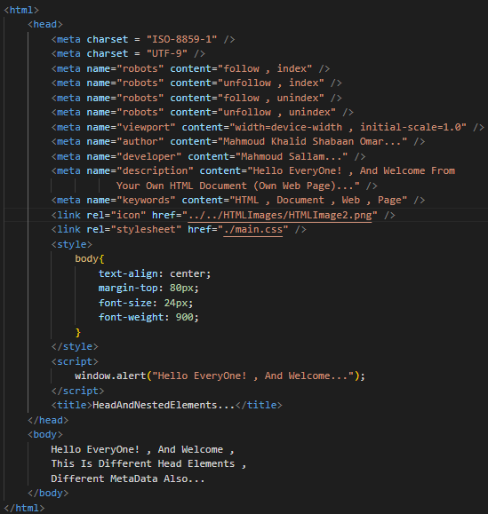
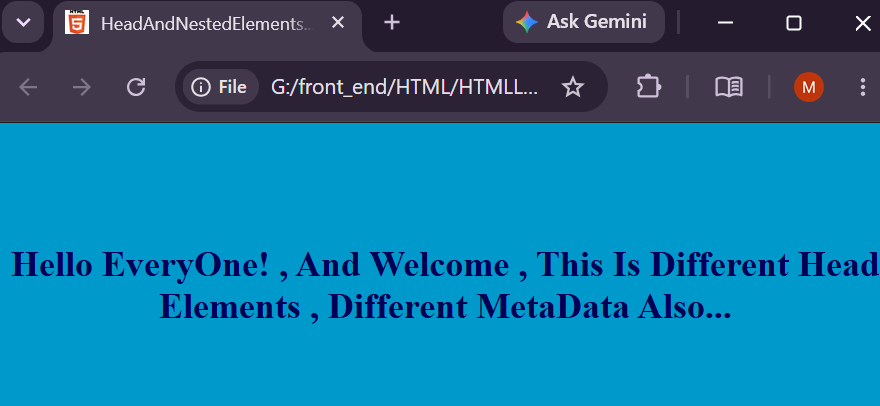

04)**Head , And MetaData:
-----------------------------
04.1)**<HEAD>: It Is A Nested HTML Tag , It Is The Head Of Your Own HTML Document (Own Web Page) , It Refers To The Collection Of The MetaData For Your Own HTML Document (Own Web Page) To Know Different Browsers Like Google Chrome , Firefox Developer Edition , Or ETC How To Archive , Or Render Your Own HTML Document (Own Web Page)...</HEAD>.

--------------------------------------------------------------------------
04.2)**MetaData: It Is A Collection Of Instructions , Or Information About Information For Your Own HTML Document (Own Web Page) To Know Different Browsers Like Google Chrome , Firefox Developer Edition To Know How To Archive , Or Render Your Own HTML Document (Own Web Page).

--------------------------------------------------------------------------
04.3)**If You Want To Add Different Types Of The MetaData , Then You Must Use: <META /> HTML Tag.

---------------------------------------------------------------------------
04.4)**<META />: It Is A Self Closing Tag , Void Tag (It Does Not Return Any Contents For Different Users Of Your Own HTML Document (Own Web Page) , Empty Tag (It Does Not Contain Any Content , Because It Does Not Contain </Closing Tag> , And Tag Scope , But Inside The <META /> Tag Only Contains A Collection Of Instruction , Or Information About Information For Different Browsers Like Google Chrome , Firefox Developer Edition , Or ETC How To Archive , Or Render Your Own HTML Document (Own Web Page).

----------------------------------------------------------------------------
04.5)**There Are Different Types Of The MetaData Like:
------------------------------------------------------
04.5.1)**<META name="description" content="Small Description Of Your Own HTML Document (Own Web Page)" /> : It Is Mainly Used To Add The Small Description For Your Own HTML Document (Own Web Page) , It Does Not Appear In Your Own HTML Document (Own Web Page) In Different Browsers Like Google Chrome , Firefox Developer Edition , Or ETC , But It Appears In The Searching Result In Different Browsers Like Google Chrome , Firefox Developer Edition , Or ETC Under The Title Of Your Own HTML Document (Own Web Page) , And Finally It Makes Your Own HTML Document (Own Web Page) SEO Friendly.

|  |  |

-----------------------------------------------------------------------------
04.5.2)**<META name="keywords" content="HTML , Document , Web , Page" /> : It Is Mainly Used To Add More Than Keywords About Your Own HTML Document (Own Web Page) For Different Browsers Like Google Chrome , Firefox Developer Edition , Or ETC To Make Your Own HTML Document (Own Web Page) SEO Friendly , You Must Know That Different Keywords Is Not Appearing For Different Users Of Your Own HTML Document (Own Web Page).

------------------------------------------------------------------------------
04.5.3)**<META name="viewport" content="width=device-width , initial-scale=1.0" /> : It Is Mainly Used To Make Your Own HTML Document (Own Web Page) Responsive In Different Screens Like Smart Phone , PCs , Laptops , Or ETC By Using Any CSS Library Like TailwindCSS , Or BootStrapCSS.

------------------------------------------------------------------------------
04.5.4)**<META name="author" content="Author Of HTML Document" /> : It Is Mainly Used To Add The Author Of Your Own HTML Document (Own Web Page).

------------------------------------------------------------------------------
04.5.5)**<META name="developer" content="Developer Of HTML Document" /> : It Is Mainly Used To Add The Developer Of Your Own HTML Document (Own Web Page).

------------------------------------------------------------------------------
04.5.6)**<META name="robots" content="follow , index" /> : It Is Used To Allow Your Own HTML Document (Own Web Page) Follows Link , And Make Your Own HTML Document (Own Web Page) SEO Friendly.

-------------------------------------------------------------------------------
04.5.7)**<META name="robots" content="nofollow , index" /> : It Is Used To Do Not Allow Your Own HTML Document (Own Web Page) Follows Link , But Make Your Own HTML Document (Own Web Page) SEO Friendly.

-------------------------------------------------------------------------------
04.5.8)**<META name="robots" content="follow , noindex" /> : It Is Used To Allow Your Own HTML Document (Own Web Page) Follows Link , But Does Not Make Your Own HTML Document (Own Web Page) SEO Friendle.

-------------------------------------------------------------------------------
04.5.9)**<META charset="ISO-8859-1" /> : It Is Used To Determine The Characters Set For Your Own HTML Document (Own Web Page) To Determine Which Specified Characters That Archiving , Or Rendering In Your Own HTML Document (Own Web Page) , But It Does Not Support Arabic Language.

-------------------------------------------------------------------------------
04.5.10)**<META charset="UTF-8" /> : It Is Used To Determine The Characters Set For Your Own HTML Document (Own Web Page) To Determine Which Specified Characters That Archiving , Or Rendering In Your Own HTML Document (Own Web Page) , It Supports Arabic Language.

-------------------------------------------------------------------------------
04.6)**<TITLE> : It Is A Nested Tag , It Is Mainly Used To Make The Title Of Your Own HTML Document (Own Web Page) , It Appears In The Top Left Of Different Browsers Like Google Chrome , Firefox Developer Edition , Or ETC , And Also Appearing In The Searching Results In Different Browsers Like Google Chrome , Firefox Developer Edition , Or ETC , It Does Not Appear For Different Users Of Your Own HTML Document (Own Web Page).</TITLE).

|  |  |

--------------------------------------------------------------------------------
04.7)**.

---------------------------------------------------------------------------------
04.8)**.

---------------------------------------------------------------------------------
04.9)**<LINK />: It Is A Self-Closing HTML Tag , Void Tag , Empty Tag , That Mainly Used To Add Icon For Your Own HTML Document (Own Web Page) Like: <LINK rel="icon href="SourceOfTheIcon" />.

|  |  |

----------------------------------------------------------------------------------

|  |  |
