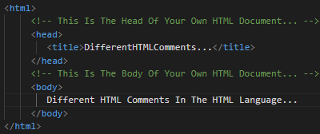
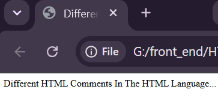

05)**HTML Comments And Use Cases:
----------------------------------
05.1)**There Are Different Types Of The Comment In The HTML Language Like:
--------------------------------------------------------------------------
05.1.1)**Single Line Comment: Control (CTRL) + "ظ" : It Is Mainly Used To Make A Single Line Comment In Your Own HTML Document (Own Web Page) Like <!-- Single Line Comment ->. 
---------------------------------------------------------------------------
05.1.2)**Multiple Lines Comment: It Is Mainly Used To Make A Multiple Lines Of Comments In Your Own HTML Document (Own Web Page). Like <!-- Single Line Comment One...
                 Single Line Comment Two...
                 Single Line Comment Three... ->
                 
---------------------------------------------------------------------------
05.2)**Different HTML Comments From The HTML Language Does Not Render , Or Archive By Different Browsers Like Google Chrome , Firefox Developer Edition , Or ETC For This Reason Different Comments Does Not Appear For Different Users Of Your Own HTML Document (Own Web Page).

-----------------------------------------------------------------------------
05.3)**Different HTML Comments From The HTML Language Is Used As A Tool Tip For Different Developers , And Users Of Your Own HTML Document (Own Web Page) To Know Why Using This HTML Line In Your Own HTML Document (Own Web Page).

-------------------------------------------------------------------------------
05.4)**You Should Use Different Types Of HTML Comments From The HTML Language In Your Own HTML Document (Own Web Page) As A Reference Tool To Know What Is The Meaning Of This HTML Line , And What You Use This HTML Line...

-------------------------------------------------------------------------------
|  |  |
