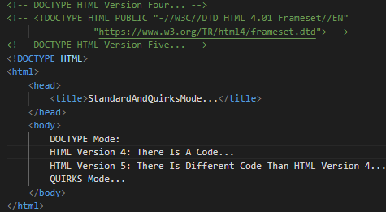
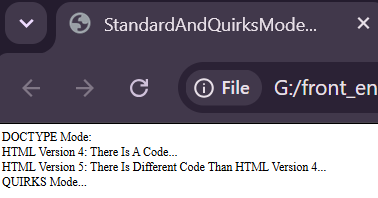
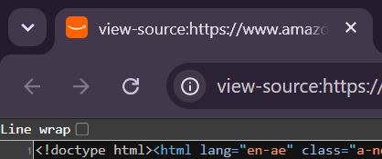

06)**DOCTYPE Mode , Or QUIRKS Mode:
------------------------------------
06.1)**Any HTML Document (Web Page) Is Rendering , Or Archiving By Different Browsers Like Google Chrome , Firefox Developer Edition , Or ETC By One Of Two Modes Like:
---------------------------------------------------------------
06.1.1)**QUIRKS Mode وضع المراوغة: If You Do Not Determine The Version Of The HTML That Mainly Used To Build Your Own HTML Document (Own Web Page) , It Appears Some HTML Tags In A Falsey Way That Loss Some Features Of Any HTML Tag From The HTML Language , And It Does Not Make Different HTML Tags Appear In A Default Behavior Of This HTML Tag.

-----------------------------------------------------------------
06.1.2)**DOCTYPE Mode: If You Determine The Version Of The HTML Language That Mainly Used To Build Your Own HTML Document (Own Web Page) , It Appears Some HTML Tags In A Truthy Way That Contains All Features Of Any HTML Tags From The HTML Language , And Finally It Appears Different HTML Tags From The HTML Language In The Default Behavior Of This HTML Tags.

------------------------------------------------------------------
06.2)**Different Types Of The DOCTYPE From The HTML Language:
------------------------------------------------------------------
06.2.1)**DOCTYPE HTML Version 4: <!DOCTYPE HTML PUBLIC "-//W3C//DTD HTML 4.01 Frameset//EN" "https://www.w3.org/TR/html4/frameset.dtd">.

---------------------------------------------------------------------
06.2.2)**DOCTYPE HTML Version 5: <!DOCTYPE html>.

---------------------------------------------------------------------
|  |  |

----------------------------------------------------------------------
|  |

----------------------------------------------------------------------
06.3)**DOCTYPE: It Is Not One Of Different HTML Tags From The HTML Language , But It Is A Collection Of Instructions For Your Own HTML Document (Own Web Page) How To Archive , Or Render Different HTML Tags From The HTML Language In Your Own HTML Document (Own Web Page).

------------------------------------------------------------------------
