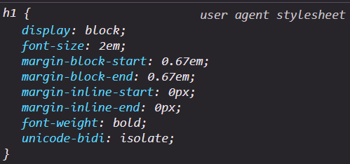
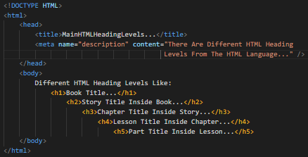
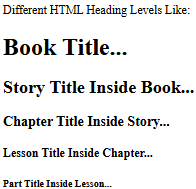

07)**Different HTML Heading Levels:
------------------------------------
07.1)**HEADING HTML Tag Is Mainly Used To Make A Head In Your Own HTML Document (Own Web Page) By Using One Of Different Heading Levels From H1 To H6 From The HTML Language.

-----------------------------------------------------------------------
07.2)**There Are Different Heading Levels From H1 To H6 From The HTML Language Like:
-----------------------------------------------------------------------------------------
07.2.1)**H1: It Is A Nested HTML Tag , It Is The Frist , And Main Heading Level From The HTML Language.

-----------------------------------------------------------------------------------------
07.2.2)**H2: It Is A Nested HTML Tag , It Is The Second Heading Level From The HTML Language.

-------------------------------------------------------------------------------------------
07.2.3)**H3: It Is A Nested HTML Tag , It Is The Third Heading Level From The HTML Language.

-------------------------------------------------------------------------------------------
07.2.4)**H4: It Is A Nested HTML Tag , It Is The Fourth Heading Level From The HTML Language.

-------------------------------------------------------------------------------------------
07.2.5)**H5: It Is A Nested HTML Tag , It Is The Fifth Heading Level From The HTML Language.

-------------------------------------------------------------------------------------------
07.2.6)**H6: It Is A Nested HTML Tag , It Is The Sixth , And Lowest Heading Level From The HTML Language.

-------------------------------------------------------------------------------------------
07.3)**When Using Different Heading Levels From The HTML Language , You Must Follow Hirarichal Ordering To Make Your Own HTML Document (Own Web Page) SEO Friendly To Appear In The Frist Searching Results In Different Browsers Like Google Chrome , Firefox Developer Edition , Or ETC...

----------------------------------------------------------------------------------------------
07.4)**If You Have A Large Text Then You Must Use P HTML Tag From The HTML Tag , And Finally If You Have A Heading You Must Use Any Heading Level (From H1 To H6) In Your Own HTML Document (Own Web Page).

----------------------------------------------------------------------------------------------
07.5)**Different Heading Levels From The HTML Language Have A Custom CSS Styling , Or Custom CSS Decorations From The UA Stylesheet (User Agent Stylesheet) Like Font-Weight: Bolder , Font-Style: Normal , Padding From All Direction , Margin Of All Directions , And More...

---------------------------------------------------------------------------------------------
07.6)**Different Styling , Or Decorations For H1 HTML Tag From The UA Stylesheet (User Agent Stylesheet) Like:
--------------------------------------------------------------------------------------------------------------

--------------------------------------------------------------------------------------------------------------

|  | 

--------------------------------------------------------------------------------------------------------------
