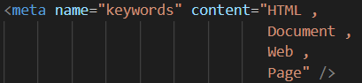
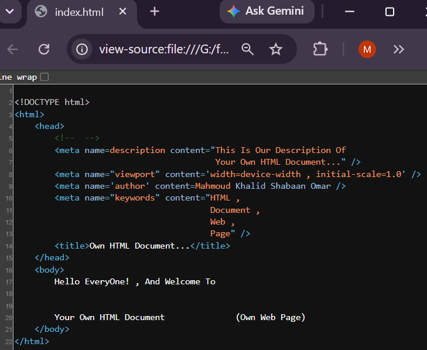
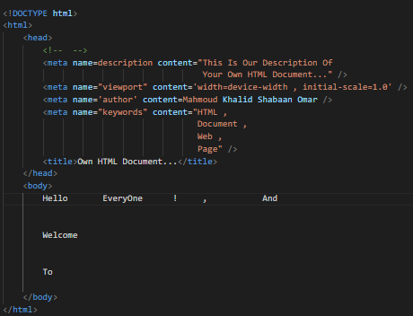
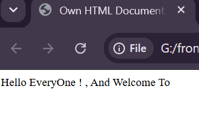

08)**Syntax , And Tests:
--------------------------
08.1)**Different Browsers Like Google Chrome , Firefox Developer Edition , Or ETC Agnors Different Spaces In Your Own HTML Document (Own Web Page) , Because Different Browsers Like Google Chrome , Firefox Developer Edition , Or ETC Does Not Know The Length , And Width Of Any Distance In Your Own HTML Document , But It Appears In The View Page Source Of Your Own HTML Document (Own Web Page).

--------------------------------------------------------------------------
08.2)**Different Values Of Different HTML Attributes Must Put Between Single Quotation , Or Double Quotation If The Value Of The HTML Attribute Is More Than One Word , Because If You Do Not Put Between Single Quotation , Or Double Quotation , Different Browsers Like Google Chrome , Firefox Developer Edition , Or ETC Takes The Frist Word As The Value Of The HTML Attribute , And Working With Other Values As A New HTML Attributes  , But The Value Of The HTML Attribute Is Only One Word , You Can Put This Value Without Using Single Quotation , Or Double Quotation , Because It Is Only One Word , And You Can Write The Value Of Any HTML Attribute In More Than One Line , But It Appears In The View Page Source Of Your Own HTML Document (Own Web Page) In The Same Way.

---------------------------------------------------------------------------

**In This Example Different Browsers Like Google Chrome , Firefox Developer Edition , Or ETC Work With Other Words Except Mahmoud (The Value Of The Content HTML Attribute) , And Works With (Khalid , Shabaan , And Omar) As A New HTML Attribute.

----------------------------------------------------------------------------

**In This Example , Putting The Value Of The HTML Attribute Into More Than One Lines Between Single Quotations , Or Double Quotations , But The Value Of The HTML Attribute Appears In Only One Line In The Page Source Of Your Own HTML Document (Own Web Page).

--------------------------------------------------------------------------

--------------------------------------------------------------------------
|  | 
